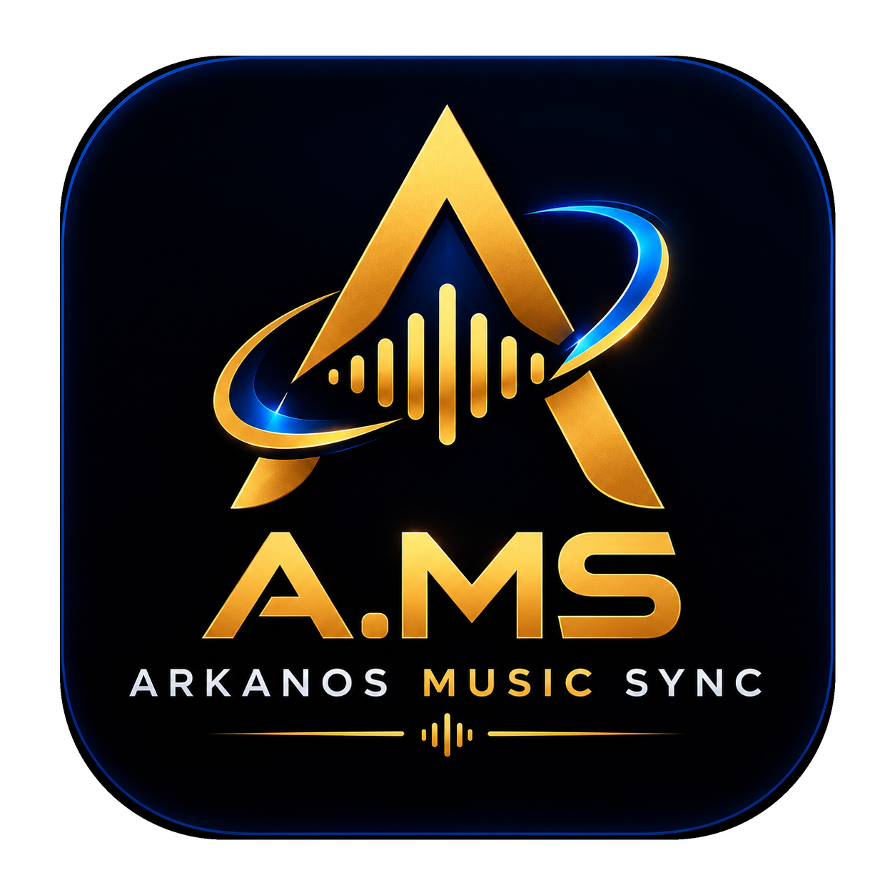

<p align="center">
  
</p>

# A.MS — Arkanos Music Sync

<p align="center">
  <strong>Synchronisation musicale intelligente, autonome &amp; locale pour audiophiles</strong><br />
  Organisation : <strong>Studio-Arkanos</strong> · Identifiant Android : <code>com.arkanos.ams</code> · Langue : français.
</p>

> **Statut : audit / réparation en cours de validation sur appareil.**
> Les fonctions locales (scan SAF, lecteur natif, favoris et playlists via stockage WebView) sont implémentées. La compilation web et les tests automatisés sont vérifiables ; une compilation Android et un essai sur Android 11 ARMv7 restent à réaliser pour cette révision. Room a été retiré car aucun pont ne l'utilisait. Aucune donnée n'est fabriquée.

## Identité visuelle & Logo officiel

Le logo officiel d'**A.MS** réunit les dimensions fondamentales du projet :
- **L'arche orbitale cyan électrique** : symbolise la synchronisation dynamique continue et l'échange de métadonnées.
- **Le « A » d'or angulaire** : signature emblématique de l'écosystème *Studio-Arkanos*.
- **L'égaliseur audio central** : ondes sonores verticales dorées incarnant le cœur musical et l'analyse de bibliothèque.
- **Le badge squircle nuit & lueur bleue** : intégration moderne et lisibilité maximale sur thème sombre.

### Ressources graphiques (`public/branding/`)

- `public/branding/ams-logo.png` : image source officielle complète (1254 × 1254 px, badge + typographie A.MS).
- `public/branding/ams-badge.png` : badge squircle détouré pour l'interface web, les bannières et la documentation.
- `public/branding/ams-symbol.png` : symbole épuré haute résolution (A + halo + ondes, fond transparent) pour les icônes applicatives.
- `public/branding/ams-symbol-{64,128,192,512}.png` & `favicon.png` : déclinaisons pré-dimensionnées nettes à toute résolution.
- **Icônes Android** : adaptive icon (`mipmap-*/ic_launcher_foreground.png` centré dans la zone sûre de 66 dp sur fond `#0B1220`) et icônes legacy rondes et squircles (`ic_launcher.png`, `ic_launcher_round.png`).
- **Écrans de démarrage (Splash)** : fonds natifs Android (`drawable-*/splash.png`) aux couleurs officielles Arkanos.

## Fonctionnalités par module

| Module | Statut |
| --- | --- |
| Import de playlist locale (M3U/PLS/TXT) | ✅ Sans clé / hors ligne (titres; pas de résolution automatique des chemins) |
| Analyse de playlist YouTube (Data API v3) | ⚪ Optionnelle (clé, réseau et quota requis) |
| Scan de bibliothèque locale (SAF) | ✅ Opérationnel (Android) |
| Normalisation / doublons / exclusions | ✅ Opérationnels (testés) |
| Décisions en attente + notifications | ✅ Opérationnel |
| Recherche fédérée (Jamendo + YouTube) | ✅ Opérationnelle |
| Téléchargement autorisé (Jamendo, DownloadManager) | ✅ Opérationnel (Android) |
| Association playlist ↔ fournisseurs | ✅ Opérationnelle |
| Import d'URL vérifié | ✅ Opérationnel |
| Liste de suivi YouTube | ✅ Opérationnelle |
| Lecteur audio (fichiers locaux + téléchargements) | ✅ Opérationnel (Android) |
| Favoris | ✅ Opérationnels (persistés) |
| Playlists utilisateur | ✅ Opérationnelles (persistées) |
| Exécution de synchronisation (orchestration) | ✅ Opérationnelle (Android) |
| Arrière-plan (WorkManager — analyse périodique) | ✅ Opérationnel (Android) |
| Écran de diagnostic | ✅ Opérationnel (états réels) |
| Conversion audio | ⚪ Non intégrée (documenté) |
| Persistance locale | ✅ localStorage WebView ; Room supprimé car non raccordé |

## Fournisseurs

- **Jamendo** — recherche, métadonnées, téléchargement
  autorisé (`audiodownload_allowed`, licences Creative
  Commons affichées). client_id requis (gratuit).
- **YouTube** — recherche et métadonnées UNIQUEMENT.
  Aucune extraction audio (conditions d'utilisation).
  clé API v3 requise.

Détail : [docs/PROVIDERS.md](docs/PROVIDERS.md).

## APK (artefact CI)

L'APK installable est produit par GitHub Actions :
menu **Actions** → workflow **Android APK** →
artefact **A-MS-debug** (`A-MS-debug.apk`).
Installation, mise à jour, précautions debug vs
release : [docs/INSTALLATION.md](docs/INSTALLATION.md).
Build local et signature release :
[docs/BUILD_ANDROID.md](docs/BUILD_ANDROID.md).
Limitations réelles : [docs/KNOWN_LIMITATIONS.md](docs/KNOWN_LIMITATIONS.md).

## Prérequis et coûts

- **Node.js ≥ 22** (compilation uniquement)
- Android Studio / GitHub Actions pour construire l'APK
- Aucun compte, clé API, abonnement ou serveur requis pour scanner et lire les fichiers locaux.
- Les intégrations réseau sont facultatives : YouTube Data API exige une clé et reste soumise au quota Google ; Jamendo exige un `client_id` et n'autorise les téléchargements que pour les titres concernés. Ces intégrations ne sont pas nécessaires à la bibliothèque locale.

L'application installée ne requiert ni Termux, Python, Node.js, serveur web ou VPS. Le scan et la lecture fonctionnent hors ligne après sélection du dossier via SAF. Les téléchargements nécessitent Internet et une URL directe effectivement autorisée.

## Installation et développement

```bash
npm ci                 # dépendances verrouillées
npm run dev            # dev web (preview)
npm run typecheck      # TypeScript strict
npm run lint           # ESLint
npm test               # 187 tests unitaires
npm run build          # build web → dist/
npm run cap:sync       # injection dans le projet Android
npm run cap:open:android
npm run android:build  # APK debug (requiert le SDK)
```

## Garanties implémentées

- Téléchargement **uniquement** depuis des sources
  autorisées (Jamendo avec `audiodownload_allowed`) ;
- un fichier existant n'est **jamais écrasé**
  (suffixe automatique + garde native) ;
- le résultat est **vérifié** (type MIME audio, taille)
  — un HTML reçu est un échec, jamais un succès ;
- les exclusions de l'étape 2 priment sur tout
  automatisme de téléchargement ;
- les correspondances incertaines exigent une
  confirmation explicite ;
- la lecture couvre UNIQUEMENT les fichiers locaux
  (bibliothèque scannée, téléchargements autorisés)
  — jamais de flux distant, jamais d'extraction
  YouTube ;
- aucune extraction YouTube, aucun contournement de
  paywall/DRM.

## Audit / limites et instructions

Le rapport honnête des causes, choix, coûts, compatibilités et validations est dans [docs/REPORT_AUDIT_AND_REPAIR.md](docs/REPORT_AUDIT_AND_REPAIR.md). Pour la bibliothèque Android 11, choisissez toujours le dossier avec **SAF** ; un chemin tapé `/storage/...` ne donne pas de permission.

## Documentation

- [docs/ARCHITECTURE.md](docs/ARCHITECTURE.md)
- [docs/TECHNOLOGIES.md](docs/TECHNOLOGIES.md)
- [docs/DEVELOPMENT.md](docs/DEVELOPMENT.md)
- [docs/PROVIDERS.md](docs/PROVIDERS.md)
- [docs/ROADMAP.md](docs/ROADMAP.md)
- [docs/INSTALLATION.md](docs/INSTALLATION.md)
- [docs/BUILD_ANDROID.md](docs/BUILD_ANDROID.md)
- [docs/TESTS.md](docs/TESTS.md)
- [docs/KNOWN_LIMITATIONS.md](docs/KNOWN_LIMITATIONS.md)

## Licence

MIT — Studio-Arkanos.
